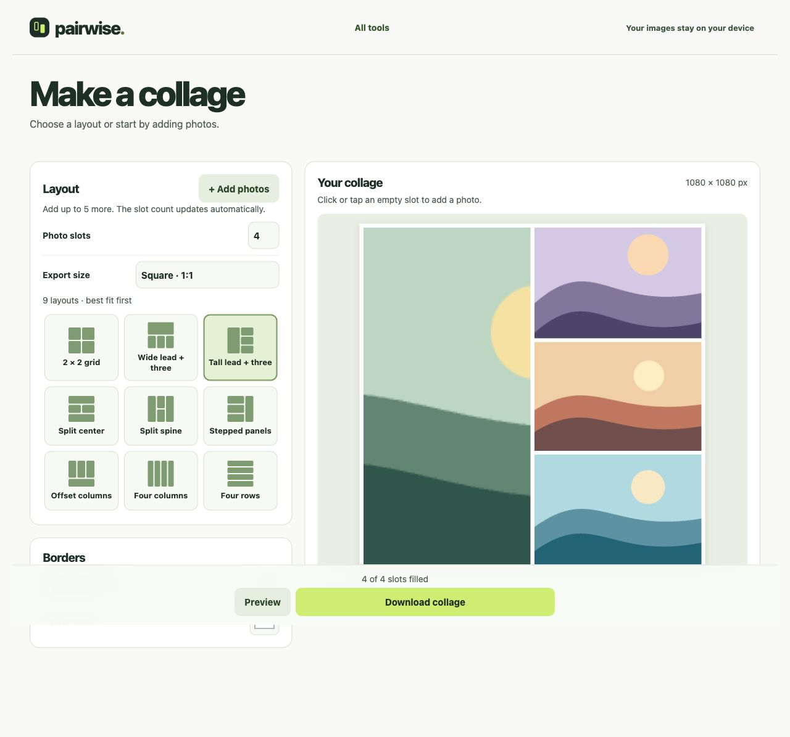

# Web editor parity

## Requirements and source

Requested: implement the improvements from the accepted phone prototype in the existing Pairwise website. Reference implementation: [pairwise-mobile at 136b59c](https://github.com/JuliaMathias/pairwise-mobile/tree/136b59c71bbbb51d5a81e712f99caca23c862d1d), read-only snapshot. Its native Android follow-up is separate work. This document and [issue #2](https://github.com/JuliaMathias/pairwise/issues/2) track web scope.

Confirmed scope:
- Keep the batch joiner, filename sorting, configurable group size, partial final groups, file naming/offsets, PNG/ZIP downloads and corrected ZIP timestamps.
- Add manual queue reordering and restore-by-name, free/fixed-ratio crop, immediate preview with export dimensions, transparent/solid padding, proportional resize, border color and thickness.
- Add a collage workspace: import up to nine photos, set slot count from accepted images, offer exact-count layouts, six fixed export sizes, at least five layouts for each 4–9-photo/export-size combination and aspect-aware ranking.
- Reframe within a collage slot by dragging; drag into another slot to swap; retain a button-based swap alternative. Include zoom slider and two-pointer pinch anchored to the fingers' midpoint.
- Local browser processing; no Lara, shared AI, remote image uploads, new dependencies or stored private content. Preserve current hosted audience.

Implementation choice: retain the accepted prototype's layout/geometry and image-editing modules, adapt the UI to a responsive desktop workspace, and keep the modes' state separate while navigating. Sample images are synthetic drawings generated locally. The shared geometry is introduced before the UI integration so existing join behavior remains usable at that intermediate commit.

## Architecture decision

Pure modules (`core`, `crop`, `composer`, `collage-layouts`) own ordering, rectangles, fitting and gesture math. DOM controllers own browser events, current photos and selection state; the photo adapter owns decoding, PNG encoding and download URL cleanup. This keeps calculations testable without real files, network or hardware, while real browser checks establish decoding/rendering/download behavior.

Alternative: build an independent web geometry engine. Rejected because the accepted prototype already implements the same behavior and duplicating the algorithms would introduce drift. This is a source port pinned to a commit, not a live cross-repository dependency. Future changes in either repository need explicit reconciliation.

Tradeoff: collage fills slots with proportional cover cropping, whereas the joiner defaults to retaining original pixels. The UI must explain the selected mode. Reducing the collage template size preserves extra photos in an unplaced tray rather than discarding them.

Layout inspiration: [Canva's grid collection](https://www.canva.com/templates/s/grid/) and [collage maker](https://www.canva.com/photo-collages/) illustrate grid, feature-panel and mosaic families. The imported patterns are original source from the user's prototype; no third-party images or templates are copied. Layout ranking penalizes extreme cell aspect ratios but leaves unusual options available.

Gesture contract: [MDN Pointer Events](https://developer.mozilla.org/en-US/docs/Web/API/Pointer_events) and [pinch example](https://developer.mozilla.org/en-US/docs/Web/API/Pointer_events/Pinch_zoom_gestures) inform pointer capture/cancellation and two-pointer tracking. Restrict `touch-action: none` to photo/crop editing areas; preserve page scrolling and browser zoom elsewhere.

## Delivery and verification plan

1. Port and test pure geometry/ordering/crop/layout modules. Existing join/ZIP regressions must pass.
2. Integrate the responsive editor and retained prototype interactions. Add only fixes supported by observed failures.
3. Browser-test synthetic imports, crop/reorder, live output sizes, fits/borders, collage exact-count filtering, layout and size changes, mouse swap/reframe, zoom controls, and PNG/ZIP output. Check desktop and narrow layouts and keyboard alternatives.
4. Publish to the same Sites project, push the issue branch and leave the review PR unmerged. Verify issue Development link, project status and milestone. Record unrun phone/two-finger checks visibly.

Status: implementation ready for code review. Geometry and responsive UI are implemented; local verification passed as recorded below. Private Sites publication and review metadata are recorded in issue #2 after the source commit is finalized. The issue remains open for physical-phone acceptance. No CI is configured. Real phone pinch and native file-picker behavior need device evidence; synthetic math tests alone do not establish those outcomes.

## Manual acceptance procedure

Prerequisites: this issue branch/revision, Node.js for automated checks, Python 3 for local serving, and a browser with canvas and Pointer Events. Start `python3 -m http.server 4173 --bind 127.0.0.1 --directory dist` from the repository root, then open http://127.0.0.1:4173. For the hosted check, open the Pairwise URL and sign in as the owner. Keep local tests distinct from hosted/device checks.

Exact data: the built-in **Try with sample images** generates `sample-1.png` (300×190), `sample-2.png` (300×200), `sample-3.png` (290×210), and `sample-10.png` (250×220). They contain synthetic scenes and are safe to use. To test the import limit, create ten 300×200 solid PNGs in a new temporary directory with the command below; it refuses to overwrite existing fixture files:

```sh
python3 - <<'PYFIXTURES'
from pathlib import Path
import struct, zlib
root = Path('/tmp/pairwise-web-review-fixtures')
root.mkdir(exist_ok=True)
def chunk(kind, data):
    return struct.pack('>I', len(data)) + kind + data + struct.pack('>I', zlib.crc32(kind + data))
for index in range(1, 11):
    color = bytes((20 * index, 240 - 20 * index, 80))
    raw = (b'\0' + color * 300) * 200
    png = b'\x89PNG\r\n\x1a\n' + chunk(b'IHDR', struct.pack('>IIBBBBB', 300, 200, 8, 2, 0, 0, 0)) + chunk(b'IDAT', zlib.compress(raw)) + chunk(b'IEND', b'')
    with (root / f'photo{index}.png').open('xb') as file:
        file.write(png)
with (root / 'corrupt.png').open('x') as file:
    file.write('not an image')
with (root / 'unsupported.txt').open('x') as file:
    file.write('unsupported synthetic fixture')
PYFIXTURES
```

| Step | Action | Expected result |
| --- | --- | --- |
| 1 | Choose Join images, then Try with sample images. | Natural order 1, 2, 3, 10; two groups; first vertical preview 300×390. |
| 2 | Move sample-3 up with its button or drag grip. Crop sample-1 to 1:1 and Apply crop. | Custom order 1, 3, 2, 10; crop is 190×190; preview changes immediately. Grip arrow keys also reorder. |
| 3 | Set Resize to match and border 10. Set file name Web-check and offset 10. Generate and download PNG/ZIP. | First PNG Web-check-011.png is 310×530; second is Web-check-012.png, 320×494. ZIP entries match individual PNGs and contain current dates. |
| 4 | Sort by name, choose group size 3, Horizontal, Solid background #123456. Add corrupt.png and unsupported.txt. | Order restored; groups of 3 and 1; first preview 820×230; both invalid files reported and excluded; previous results cleared. |
| 5 | Return to All tools and choose Make a collage. Import photo1 through photo10. | Exactly nine photos accepted, 9 slots filled, 15 exact-count layout choices, one excess file reported, Add photos disabled at limit. |
| 6 | Select Story export, then 4 slots. | 1080×1920 board; nine four-photo layouts; five unused photos in tray; no photos discarded. |
| 7 | Select slot 1 and zoom to 200%. Use Move / swap then select slot 2. | Names swap; zoom/framing travels with the photo. Dragging a photo onto another slot also swaps their contents. |
| 8 | Drag inside a zoomed slot; use its arrow keys. Reset framing. | Image position changes within slot; no uncovered space; reset restores zoom 100% and centered pan. |
| 9 | Save collage, open PNG. Change export to Wide and slots to 9. | Story PNG is 1080×1920; all nine photos restored from tray; Wide preview is 1920×1080 with 15 exact-count choices. |
| 10 | Use sample scenes, choose square and Tall lead + three. Check at 1280px and 390px widths, keyboard focus and crop dialog. | Responsive two-column desktop / single-column narrow layout; no horizontal page or dialog overflow; controls and downloads remain accessible. |
| 11 | On a physical touch phone in its actual browser, import 4 photos and pinch a filled slot with two fingers; drag within/across slots. Try selecting files in any intended embedded browser too. | Pinch zoom is smooth and anchored near finger midpoint; cross-slot drag swaps; inside drag reframes. Browser page scrolling/zoom still works outside editing areas. Picker succeeds or a platform restriction is recorded. |

Pass/fail: ordering, crops, counts, dimensions, output filenames and slot assignments must match. A missing photo, overlap/gap not accounted for by a border, stretched export, failed download, unbounded framing, unreported invalid input or inaccessible essential control is a failure. A screenshot is visual evidence, not proof of gesture/export behavior.

Record: source SHA, browser and OS/device, viewport, actual action/result, PNG dimensions, ZIP entry names/CRCs/dates, and screenshots or gesture recording containing synthetic images only. Cleanup: Clear all / Clear photos; remove only the named synthetic fixtures and test downloads if desired. Preserve user originals. Reload clears editor state.

## Executed verification — 18 November 2026

- **Passed:** 22 deterministic Node tests. Existing 11 join/naming/ZIP tests are retained; eight geometry/crop/layout tests cover editing, all 36 large-photo-count/export-size combinations, layout uniqueness/tiling and anchored pinch math. Three photo-adapter tests use a fake decoder to verify accepted/fallback MIME handling, rejected/corrupt/oversized inputs, URL cleanup and encoder failure. These are not live device tests.
- **Passed:** syntax checks for all browser modules and staged whitespace checks.
- **Passed in actual in-app browser, local preview:** sample import, natural/manual sorting, button and keyboard reorder, square crop apply/cancel, proportional sizing/border preview (310×530), named PNG/ZIP downloads, group 3 + partial final group, horizontal solid padding, and invalid-file reporting.
- **Passed in actual in-app browser, local preview:** ten-file picker import accepts nine and reports one excess; auto slot count and exact-count layouts; Story→Wide export size changes; reduced slots preserve five photos in tray; zoom slider; button swap and native mouse drag-to-swap; drag reframing changed image CSS coordinates; restoring nine slots restores all nine photos. Story PNG downloaded at 1080×1920. Separate state survives navigating between the two modes.
- **Passed:** downloaded edited join PNG 310×530 and collage PNG 1080×1920 verified from actual PNG headers. ZIP names 011/012, CRCs, current dates and byte equality with individual PNG were verified locally.
- **Passed:** desktop 1280×900 and narrow 390×844 checks; page width matched viewport; crop dialog had no horizontal overflow. No browser console errors were captured. Desktop screenshot shows synthetic scenes only.
- **Not run:** physical-phone two-finger pinch, phone-native/embedded pickers, other browser engines, complete accessibility audit and large-memory stress. Geometry tests establish pinch calculations but not hardware gesture acceptance. CI is not configured.

Remaining plan review: implementation and local verification are done; source synchronization, private publication and unmerged PR metadata remain the delivery steps. Keep issue #2 open until phone acceptance is recorded. No architecture/dependency changes are needed based on observed browser results.

## Browser preview

This local-browser screenshot contains only the generated sample scenes. It shows the 1280px desktop layout; actual browser/export results are listed above. The phone-width check is separately recorded above, and a screenshot does not establish physical touch acceptance.


